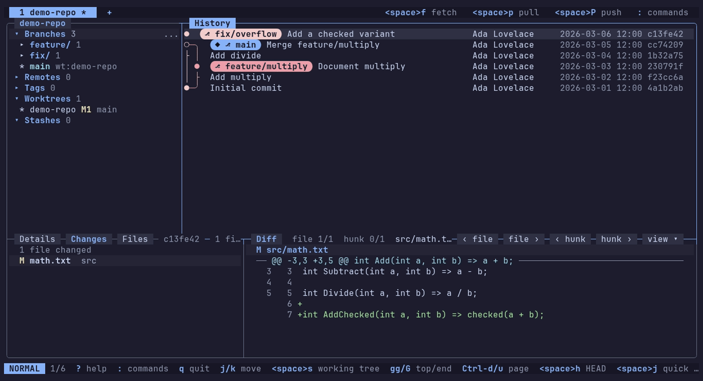

<p align="center"></p>

<h1 align="center">Gitunia</h1>

A keyboard-first terminal Git client: a real commit graph, first-class branches and worktrees, vim-style modal navigation, the mouse is optional but fully functional.



## Why

Terminal Git tools are great for quick staging and commits but awkward for many branches, worktrees and large graphs. Graphical clients get that model right but need a mouse and a desktop. Gitunia brings that model to the terminal.

## Features

- Commit graph that scrolls and searches through 100k+ commits
- Stage files, hunks and single lines, then commit or amend
- Branches, merge, rebase, reset, cherry-pick and revert
- Fetch, pull and push with progress
- Unified and side-by-side diffs, also between any two commits
- Standalone multi-repository client: tabs, repository picker, session restore
- Stashes as a first-class view
- 3-way merge conflict resolution
- Worktrees as a first-class view
- Tags, clone, init and remotes
- Interactive rebase editor
- Reflog browser as the undo path for destructive actions
- Command palette, configurable vim-style keys and full mouse support

Not included: submodules, LFS UI, blame, hosting-provider integration, plugins.

## Install

Needs Git 2.43 or newer on your `PATH`.

Ways to install: Linux `.deb`/`.rpm`, Arch/Omarchy archive, Windows and Linux archive, or from source. For more details look in the [user guide](docs/user-guide.md#install).

## Quick start

```
gitunia                 # restore the last session, or show the repository picker
gitunia ~/Projects/foo  # open a repository (any subfolder resolves to its root)
```

In the picker type to filter or type a path. `Enter` opens it in a tab. `?` shows the keys of the current view, `:` opens the command palette, `q` quits.

## Docs

- Landing page source is in `site/`; `scripts/build-site.sh` builds it for local preview
- [Customising keys](docs/customising-keys.md) and [key reference](docs/keymap.md)
- Design documents are in `docs/` (maintainer notes in `docs/internal/`)
- Project conventions are in [CLAUDE.md](CLAUDE.md)

## Contributing, security, license

See [CONTRIBUTING.md](CONTRIBUTING.md) and [SECURITY.md](SECURITY.md). Licensed under the MIT License ([LICENSE](LICENSE)). This covers the logo too.
